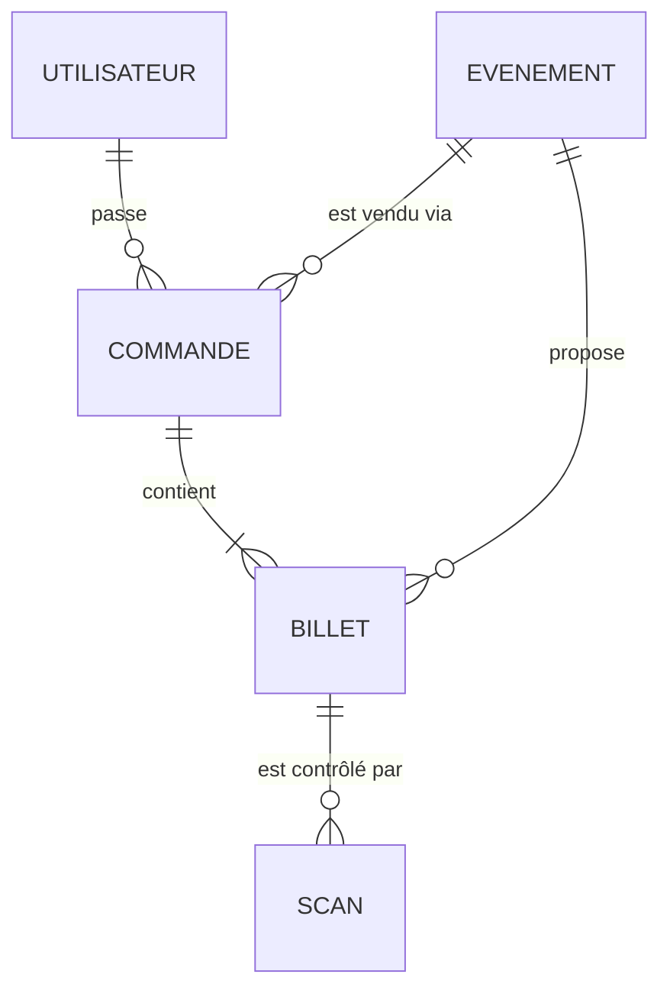

# Orbitale — modèle de ressources (livrable S1)

Date : 20 novembre 2026

## 1. Ressources métier

| Ressource   | Description en une phrase                                                      | Attributs principaux                                                                                                     | Qui la crée ?                      | Qui la lit ?                                          |
| ----------- | ------------------------------------------------------------------------------ | ------------------------------------------------------------------------------------------------------------------------ | ---------------------------------- | ----------------------------------------------------- |
| Événement   | Un spectacle ou un concert mis en vente.                                       | `title`, `venue`, `startsAt`, `capacity`, `remaining`, `price`, `currency`, `status` (`draft`, `published`, `cancelled`) | L'organisateur                     | Le site, l'application mobile, l'organisateur         |
| Billet      | Un droit d'entrée pour une personne, lié à une commande et à un événement.     | `code` (QR), `eventId`, `orderId`, `status` (`valid`, `used`, `cancelled`)                                               | L'API, quand la commande est payée | L'acheteur dans l'app, la borne au moment du contrôle |
| Commande    | Un achat d'un ou plusieurs billets pour un événement.                          | `userId`, `eventId`, `quantity`, `total`, `status` (`pending`, `paid`, `cancelled`)                                      | L'acheteur (site ou app)           | L'acheteur, l'organisateur                            |
| Utilisateur | Une personne qui achète, organise ou contrôle l'entrée.                        | `email`, `name`, `role` (`buyer`, `organizer`, `gate`)                                                                   | La personne, à l'inscription       | Elle-même, un admin                                   |
| Scan        | Le contrôle d'un billet à une porte : qui, quand, quelle borne, quel résultat. | `ticketId`, `gateId`, `scannedAt`, `result` (`accepted`, `rejected`)                                                     | La borne                           | L'organisateur (comptage des entrées), la borne       |

`remaining` n'est pas saisi : il se calcule à partir de `capacity` et des billets vendus.

## 2. Relations

- Un utilisateur passe zéro ou plusieurs commandes.
- Une commande concerne un seul événement et contient un ou plusieurs billets.
- Un événement a zéro ou plusieurs billets.
- Un billet peut être scanné zéro ou plusieurs fois (entrées refusées comprises). Un seul scan `accepted` est possible.

Les billets appartiennent à la commande : on les liste sous `/v1/orders/{orderId}/tickets`. Un billet se lit aussi seul (`/v1/tickets/{ticketId}`), pour ne pas dépasser deux niveaux d'URI. Le scan est une ressource à part : la borne le crée, elle ne modifie pas le billet avec un verbe dans l'URL.

## 3. Endpoints

| Méthode | URI                            | Rôle                                             | Succès           | Erreurs possibles                           |
| ------- | ------------------------------ | ------------------------------------------------ | ---------------- | ------------------------------------------- |
| GET     | `/v1/events`                   | Lister les événements (`?status=published`)      | 200              | 422 (filtre invalide)                       |
| POST    | `/v1/events`                   | Créer un événement                               | 201 + `Location` | 401, 422                                    |
| GET     | `/v1/events/{eventId}`         | Lire un événement                                | 200              | 404                                         |
| PATCH   | `/v1/events/{eventId}`         | Modifier quelques champs                         | 200              | 404, 409, 422                               |
| DELETE  | `/v1/events/{eventId}`         | Supprimer un événement sans vente                | 204              | 404, 409 (billets déjà vendus)              |
| POST    | `/v1/orders`                   | Créer une commande                               | 201 + `Location` | 404 (événement inconnu), 409 (complet), 422 |
| GET     | `/v1/orders/{orderId}`         | Lire une commande                                | 200              | 403, 404                                    |
| PATCH   | `/v1/orders/{orderId}`         | Changer l'état, par ex. `{"status":"cancelled"}` | 200              | 404, 409 (déjà utilisée ou déjà annulée)    |
| GET     | `/v1/orders/{orderId}/tickets` | Lister les billets d'une commande                | 200              | 404                                         |
| GET     | `/v1/tickets/{ticketId}`       | Lire un billet                                   | 200              | 403, 404                                    |
| POST    | `/v1/scans`                    | Contrôler un billet à une borne                  | 201 + `Location` | 404 (code inconnu), 409 (déjà accepté)      |
| GET     | `/v1/scans?eventId={eventId}`  | Lister les entrées d'un événement                | 200              | 404                                         |

## 4. Choix de conception

- **PATCH pour modifier un événement.** L'organisateur change souvent un seul champ (le titre, l'heure, la capacité). PATCH n'envoie que ce champ. Un PUT remplacerait toute la ressource : un oubli effacerait la description, et des champs comme `remaining` ou `id` ne sont pas modifiables. Si la nouvelle capacité est inférieure aux billets déjà vendus, on répond 409.
- **Annuler une commande sans verbe dans l'URI.** Annuler, c'est changer l'état de la commande : `PATCH /v1/orders/{orderId}` avec `{"status":"cancelled"}`. L'URI désigne la commande, le corps porte le nouvel état. On ne crée pas `POST /v1/orders/{orderId}/cancel`. Si des billets sont déjà scannés, l'annulation répond 409.
- **Ressource exposée aux bornes : le scan.** Valider un billet, c'est créer un scan : `POST /v1/scans` avec le code du billet, la porte et l'heure. On garde l'historique (qui est entré, quand, à quelle porte). La borne ne reçoit pas la commande entière. Un premier passage accepté répond 201 ; un second répond 409.
